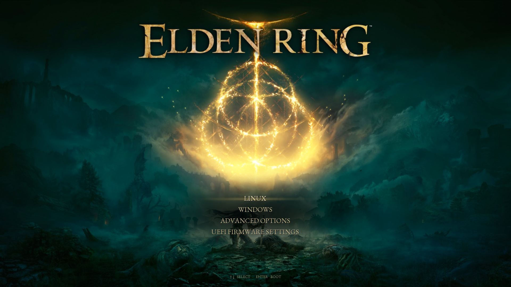

# Elden Erdtree GRUB

Elden Ring inspired GRUB themes with an optional native animation build. The latest **Shattered Ring** design has a centered gold menu, a breathing golden sigil, and flowing particles with soft trails.



**[Arch Linux setup](docs/ARCH-LINUX.md)** · **[Animated recording](docs/ring-preview.mp4)** · **[Standard installer](docs/INSTALL.md)** · **[Animated EFI guide](docs/ANIMATED-EFI.md)**

Use the current `main` branch for this version. The older [v0.1.0 release](https://github.com/MrTr4p/elden-erdtree-grub/releases/tag/v0.1.0) predates the Ring theme and particles.

## Choose an installation

| | Standard theme | Animated EFI build |
|---|---|---|
| Ring artwork and gold highlight | Yes | Yes |
| Menu placement | Centered menu area, stock left-aligned labels | Centered uppercase labels |
| Glowing sigil and flowing particles | Static artwork | Native animation |
| Selection shimmer and confirmation fade | No | Yes |
| Existing GRUB executable | Kept | Separate experimental x86_64 UEFI entry |

The screenshot and recording show the animated build. [See the standard Ring theme](docs/images/ring-standard.png). An ordinary GRUB theme cannot add animations or change the native list's text alignment; those features use the included GRUB 2.14 source patch. Sound is not included.

## Install the static Ring theme on Arch

Requires an existing, working GRUB installation. This installer does not migrate another bootloader to GRUB.

```sh
sudo pacman -Syu --needed git python python-pillow grub
git clone https://github.com/MrTr4p/elden-erdtree-grub.git
cd elden-erdtree-grub
./install.sh --variant ring --dry-run
sudo ./install.sh --variant ring
```

The installer generates the selected theme, backs up `/etc/default/grub` and your generated `grub.cfg`, adds a marked configuration block, and runs `grub-mkconfig`. Existing OS entries come from your existing GRUB scripts. A zero-second timeout becomes five seconds. Failed generation restores the saved files.

Use `--resolution 2560x1440` for another supported mode, or `--grub-dir /boot/grub2` when that is your existing GRUB directory. The artwork is designed for 16:9; other aspect ratios stretch it.

```sh
sudo ./install.sh --uninstall
```

Uninstall before updating an existing installation. Uninstall preserves unrelated settings added later. See [INSTALL.md](docs/INSTALL.md) for backups, recovery, other distributions, and long menu labels.

## Try the full animation

Install the build and VM dependencies from [ARCH-LINUX.md](docs/ARCH-LINUX.md), then:

```sh
./build.sh
python3 preview.py --variant ring --record
python3 live-preview.py --variant ring --port 8134
```

The browser shows **actual GRUB running in a diskless QEMU VM**. Demo entries print test markers, without booting your installed systems. The viewer has pause and fullscreen controls. The sigil breathes over 5.2 seconds and 38 motes rise and curl outward. The menu and logo stay still. The renderer targets 20 frames per second and adapts to slower firmware.

For the same animation at real boot, follow [ANIMATED-EFI.md](docs/ANIMATED-EFI.md) using `--variant ring`. It builds a separate image with matching patched modules and artwork. Keep your existing boot entry available. The generated image is unsigned and requires your own signing and trust setup if using Secure Boot.

## Other themes

| `--variant` | Design |
|---|---|
| `ring` | Shattered Ring: centered menu, glowing sigil, flowing gold dust |
| `grace` | Site of Grace: swaying flame, circling light, rising motes |
| `carian` | Age of the Stars: moonlight, blue stardust, glintstone blade |
| `destined` | Destined Death: crimson runes, embers, dark blade |
| `farum` | Beyond Time: floating ruins, windblown dust, distant lightning |

`grace` remains the default when no variant is supplied. The original Erdtree artwork is retained in `theme/background-erdtree.png`. Preview a variant with `preview.py --variant NAME` and `live-preview.py --variant NAME`. [BUILD.md](docs/BUILD.md) describes comparing previews, motion settings, static fallback, and rebuilding the patch.

## Verification and limits

Installer tests cover backup, rollback, overwrite refusal, preserving unrelated settings, font-generation failures, variants, and uninstall. An Arch container test uses the actual distribution menu generator and font tools; device probing is a fixture because Docker's overlay is not a boot disk. CI repeats installation checks and compiles patched GRUB on Arch and Ubuntu.

QEMU/OVMF checks cover Ring at 1920×1080 and 1024×768, particles, stable menu text, selection, confirmation, submenu, editor, console, and rapid input. The stock theme and standalone EFI image also have VM checks. [Validation reports](docs/validation/) record the evidence.

These checks do not certify physical firmware, real Linux/Windows boot, or Secure Boot. Animated scenes fall back to still artwork above 2560×1600 or if resources are unavailable. Fonts include basic Latin and arrows; long or non-Latin OS labels may require adjustment. The theme does not discover missing operating systems or rename entries.

## Credits and licenses

- GRUB and this project's code: [GPL-3.0-or-later](COPYING).
- EB Garamond: [SIL Open Font License](FONT-LICENSE.txt), from [Google Fonts](https://github.com/google/fonts/tree/main/ofl/ebgaramond).
- Ring cover: user-supplied artwork with [source attribution](concepts/ring/SOURCE.txt). Other backgrounds are AI-generated fan artwork; [provenance](docs/ARTWORK.md).
- Elden Ring names and imagery belong to their respective rights holders. This unofficial fan project is not affiliated with or endorsed by FromSoftware or Bandai Namco.

Reference: [GNU GRUB theme format](https://www.gnu.org/software/grub/manual/grub/html_node/Theme-file-format.html).
