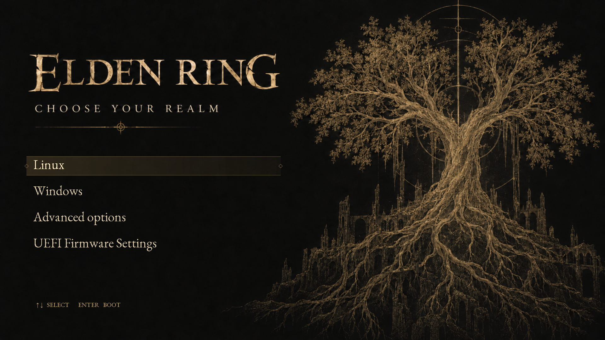

# Elden Erdtree GRUB

An Elden Ring inspired boot menu: engraved gold Erdtree artwork, a dark background, serif labels, and a completely still idle screen.



**[Watch the real GRUB recording](docs/preview.mp4)** · **[Install](#install-the-standard-theme)** · **[Build and preview](docs/BUILD.md)** · **[Animated EFI guide](docs/ANIMATED-EFI.md)**

This is a fan project. The selection shimmer and confirmation flash/fade are custom effects inspired by the game, not an exact recreation of its UI.

## Two versions

| | Standard theme | Animated build |
|---|---|---|
| Static Erdtree background | Yes | Yes |
| Keyboard selection and highlighted row | Yes | Yes |
| Gold shimmer when changing selection | No | 360 ms |
| Confirmation flash and fade | No | 170 ms flash, then 680 ms fade |
| Submenu confirmation | Normal GRUB behavior | Brief flash |
| Installation | Theme files and GRUB configuration | Custom GRUB 2.14, experimental x86_64 UEFI image |

**An ordinary GRUB theme cannot add these button animations.** The animated version includes a small native GRUB source patch. Copying only `theme.txt` installs the standard theme.

The screenshot and video show the animated build. [See the standard theme screenshot](docs/images/standard.png).

## Install the standard theme

Requires an existing working GRUB 2 installation, Python 3, and a graphical GRUB terminal. Run from Linux:

```sh
git clone https://github.com/MrTr4p/elden-erdtree-grub.git
cd elden-erdtree-grub
./install.sh --dry-run
sudo ./install.sh
```

Then reboot when convenient. The installer:

- Copies the prebuilt 1920×1080 theme into `/boot/grub/themes/elden-erdtree` or `/boot/grub2/themes/elden-erdtree`.
- Saves your defaults and generated menu in `/var/lib/elden-erdtree-grub`.
- Adds a marked block to `/etc/default/grub`, enables the graphical menu, and runs `grub-mkconfig` or `grub2-mkconfig`.
- Keeps your existing OS entries and bootloader. A zero-second timeout becomes five seconds so the menu is visible.
- Restores the saved files if configuration generation fails.

If detection is ambiguous, specify `sudo ./install.sh --grub-dir /boot/grub2`. Reinstalling over an existing installation is refused; uninstall first.

### Another resolution

The artwork is designed for 16:9. Other aspect ratios stretch the composition. GRUB must support the requested display mode; `auto` is a fallback.

Custom sizes also need Pillow and `grub-mkfont`:

```sh
# Arch
sudo pacman -S python-pillow grub
# Debian / Ubuntu
sudo apt install python3-pil grub-common

sudo ./install.sh --resolution 2560x1440
```

On systems naming the font tool `grub2-mkfont`, use `sudo env GRUB_MKFONT=grub2-mkfont ./install.sh --resolution 2560x1440`.

### Uninstall

```sh
cd elden-erdtree-grub
sudo ./install.sh --uninstall
```

This removes the theme and its marked configuration block, preserves unrelated settings added later, and regenerates the menu. If you manually damaged the marked block, use the saved backups described in [INSTALL.md](docs/INSTALL.md).

## Try the animation before installing anything

Follow [BUILD.md](docs/BUILD.md) to install build dependencies, then:

```sh
./build.sh
python3 preview.py --record
python3 live-preview.py
```

The browser displays **actual GRUB running in QEMU**, with keyboard and button input forwarded to the VM. The VM has no host disks or network. Its Linux/Windows entries print test markers; they do not start your operating systems.

For a separate animated firmware entry on compatible machines, follow [ANIMATED-EFI.md](docs/ANIMATED-EFI.md). This is an advanced, experimental path; the standard installer does not replace your GRUB executable.

## Build it exactly

[BUILD.md](docs/BUILD.md) covers the pinned GRUB download and checksum, the patch, font generation, timings, test commands, preview recording, and artwork provenance. The original generated concept is in [docs/images/concept.png](docs/images/concept.png); the cleaned artwork is [theme/background.png](theme/background.png).

## Verification and limits

The native preview was tested in QEMU/OVMF at 1920×1080 and 1024×768, including idle stability, selection, confirmation, submenu, editor, console, rapid key presses, automatic boot, and disabled effects. The ordinary theme was also tested with the system's unmodified GRUB. The standalone EFI image was tested against a disposable VM configuration. [Validation reports](docs/validation/) record the results.

These tests do not establish physical-machine boot compatibility. The animated build targets x86_64 UEFI and limits full-screen confirmation effects to at most 2560×1600. The custom fonts include basic Latin and arrow glyphs; long or non-Latin OS labels may need font/layout changes. The theme does not discover missing operating systems, rename entries, or change kernels.

## Credits and licenses

- GRUB and this project's code: [GPL-3.0-or-later](COPYING).
- EB Garamond: [SIL Open Font License](FONT-LICENSE.txt), from [Google Fonts](https://github.com/google/fonts/tree/main/ofl/ebgaramond).
- Background: AI-generated fan artwork based on the approved concept; [provenance](docs/ARTWORK.md).
- Elden Ring names and imagery belong to their respective rights holders. This project is not affiliated with or endorsed by FromSoftware or Bandai Namco.

Reference: [GNU GRUB theme format](https://www.gnu.org/software/grub/manual/grub/html_node/Theme-file-format.html).
